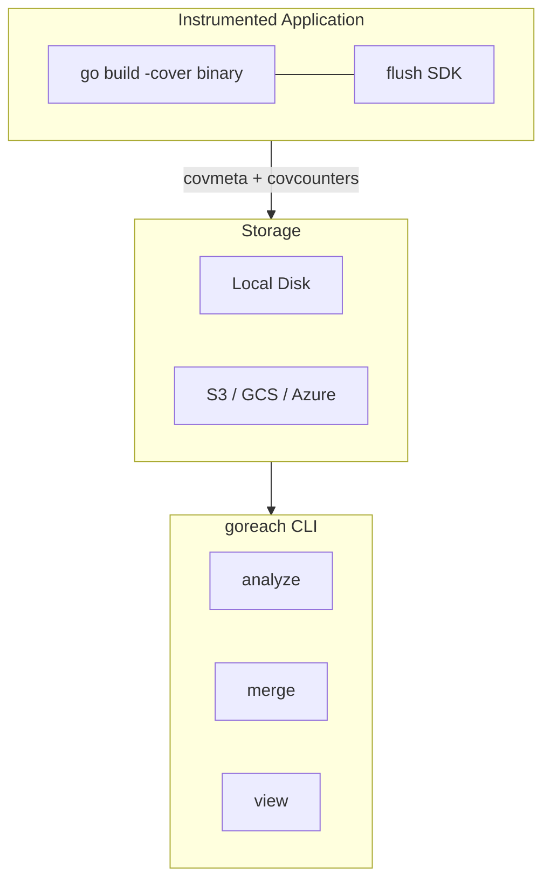

# goreach

[](https://pkg.go.dev/github.com/yag13s/goreach)
[](https://goreportcard.com/report/github.com/yag13s/goreach)
[](LICENSE)

**Find unreached code paths in running Go services.**

goreach sits on top of Go's native coverage instrumentation (`go build -cover` / `GOCOVERDIR`) and turns raw coverage data into actionable JSON reports highlighting exactly which functions and code blocks your production traffic never touches.

## Key Features

- **Production coverage analysis** -- Collect coverage from long-running services without stopping them
- **Flush SDK** -- Lightweight, zero-dependency library to emit coverage data on a schedule, via HTTP, signal, or manual trigger
- **Multi-build merge** -- Automatically reconcile coverage across different binary versions
- **Call counts** -- See how often each function was called: which handlers take the traffic, and which are never called at all
- **Hotspots & N+1 detection** -- Calls made inside loops, with how often they run per call of their caller, point at N+1 queries and hot paths
- **Web UI** -- Overview, hotspots, coverage, and a code view with per-line execution counts as a heat map
- **Cloud-agnostic storage** -- Local disk, S3, GCS, Azure, or any custom backend via a simple interface

## Install

```bash
go install github.com/yag13s/goreach/cmd/goreach@latest
```

## Quick Start

```bash
# Build with coverage
go build -cover -covermode=set -o myserver ./cmd/myserver

# Run with GOCOVERDIR
mkdir -p /tmp/coverage
GOCOVERDIR=/tmp/coverage ./myserver

# Stop the process, then analyze
goreach analyze -coverdir /tmp/coverage -pretty -o report.json
```

<details>
<summary>View the report in browser</summary>

```bash
goreach view -src . report.json
```

</details>

<details>
<summary><strong>Try without building</strong> — pre-generated sample reports</summary>

The repository includes sample reports so you can explore the viewer and merge
workflow immediately:

```bash
# View a single-build report
goreach view testdata/sample-reports/v1.json

# Merge two build versions and view
goreach merge -pretty -o testdata/sample-reports/merged.json \
    testdata/sample-reports/v1.json \
    testdata/sample-reports/v2.json
goreach view -src . testdata/sample-reports/merged.json
```

To generate fresh coverage data from the sample server:

```bash
bash testdata/sampleserver/run.sh
```

</details>

## CLI Commands

| Command | Description |
|---------|-------------|
| `goreach analyze` | Analyze coverage data and output unreached code as JSON |
| `goreach merge` | Merge multiple reports, taking max coverage per function |
| `goreach view` | Launch interactive Web UI with optional source preview |
| `goreach summary` | Print a text coverage summary |
| `goreach version` | Show version info |

<details>
<summary><strong>analyze</strong> flags</summary>

| Flag | Description | Default |
|------|-------------|---------|
| `-profile <file>` | Text coverage profile path | -- |
| `-coverdir <dir>` | GOCOVERDIR path (exclusive with `-profile`) | -- |
| `-r` | Recursively search coverdir; data from several builds is merged (see [Multi-Build Workflow](#multi-build-workflow)) | `false` |
| `-pkg <prefixes>` | Package filter (comma-separated) | all |
| `-threshold <float>` | List only functions with coverage <= X% | `100` |
| `-min-statements <n>` | List only functions with >= N unreached statements | `0` |
| `-o <file>` | Output file | stdout |
| `-pretty` | Pretty-print JSON | `false` |

`-threshold` and `-min-statements` only choose which functions are listed. File, package and report totals always cover all the code, so a filtered report shows the same coverage percentages as an unfiltered one. With `-r`, the filters are applied after the builds are merged.

</details>

<details>
<summary><strong>summary</strong> usage</summary>

```bash
# From a report: the same numbers analyze, merge and view work with
goreach summary report.json

# Straight from coverage data: no source tree needed
goreach summary -coverdir ./coverage
goreach summary -profile coverage.txt

# Call counts (see "Call Counts" below): the hottest and the never-called functions
goreach summary -top 20 report.json
goreach summary -cold -pkg myapp/handler report.json

# Calls made inside loops that repeat most: N+1 candidates
goreach summary -loops 20 report.json
```

| Flag | Description |
|------|-------------|
| `-report <file>` | report.json written by `analyze` or `merge` (also accepted as a positional argument) |
| `-coverdir <dir>` | GOCOVERDIR path |
| `-r` | Recursively search coverdir; if it holds several builds, only the newest is summarized |
| `-profile <file>` | Text coverage profile path |
| `-top <n>` | List the N most called functions instead of the package summary (needs a report) |
| `-loops <n>` | List the N calls made inside loops that ran most, with how often per call of their caller (needs a report) |
| `-cold` | List the functions that were never called instead of the package summary (needs a report) |
| `-pkg <prefixes>` | With `-top` / `-loops` / `-cold`: only packages with these import path prefixes (comma-separated) |

Summarizing coverage data directly counts every statement in the profile and never looks at source code, so it works on a machine that has only the data. It cannot merge coverage across builds, and its totals include packages `analyze` would skip for lack of source. For numbers that match a report, summarize the report.

</details>

<details>
<summary><strong>merge</strong> flags</summary>

| Flag | Description | Default |
|------|-------------|---------|
| `-threshold <float>` | List only functions with coverage <= X% | `100` |
| `-min-statements <n>` | List only functions with >= N unreached statements | `0` |
| `-o <file>` | Output file | stdout |
| `-pretty` | Pretty-print JSON | `false` |

Uses the newest report as the structural base. Takes the maximum `coverage_percent` per function across all inputs, applied to the newest report's statement counts. Deleted functions (only in older reports) are excluded.

To filter a merged report, pass `-threshold` / `-min-statements` to `merge` and leave them off the per-build `analyze` runs: a function filtered out of an input cannot gain coverage from the other inputs.

When an older build wins on coverage but lacks unreached block detail (e.g. covdata func origin), the latest build's blocks are preserved in `latest_unreached_blocks`. The viewer shows a toggle to switch between merged and latest-build block views.

</details>

<details>
<summary><strong>view</strong> flags</summary>

| Flag | Description | Default |
|------|-------------|---------|
| `-src <dir>` | Module root for the code view | current directory if it has a `go.mod`, else disabled |
| `-port <n>` | HTTP port | `0` (random) |
| `-no-open` | Don't auto-open browser | `false` |

</details>

## Multi-Build Workflow

When you deploy a new version of your service, the new build produces different coverage
metadata, so its data cannot simply be added to the previous build's. Point `analyze -r` at
the directory holding all of them and goreach reconciles the builds itself:

```bash
# Directory structure after collecting coverage from multiple deploys:
# coverage-data/
# ├── abc1234/          ← build version (git short hash)
# │   └── pod-name/
# │       ├── covmeta.*
# │       └── covcounters.*
# └── def5678/
#     └── pod-name/
#         ├── covmeta.*
#         └── covcounters.*

# Run from a checkout of the newest build's source
goreach analyze -coverdir coverage-data -r -pretty -o report.json

# View in browser (with source preview)
goreach view -src . report.json
```

`-r` finds every coverage directory under the root and groups them into builds by their
`covmeta` hash (the directory names do not matter). The newest build — the one whose latest
counter file was written last, read from the `covcounters.*` file name so copying the data
(`aws s3 sync`, `cp`) does not change it — is matched against the
source on disk and defines the report: its functions, line numbers and statement counts.
Older builds contribute each function's coverage percentage, matched **by function name**,
and the report keeps the maximum per function — so no coverage is lost when you redeploy,
and code that moved within a file between builds is still attributed correctly.
Functions that no longer exist in the newest build are left out. Functions that share a
name within one file (several `init` funcs, or a generic method and a function of the same
name) cannot be told apart in an older build's data and keep the newest build's numbers.

When an older build wins for a function, the report has no block-level detail from that
build; the newest build's unreached blocks are kept in `latest_unreached_blocks`, and the
viewer offers a toggle between the merged and latest-build views.

<details>
<summary><strong>Merging reports instead</strong> — <code>goreach merge</code></summary>

`goreach merge` combines reports that already exist, the same way: newest report as the
base, maximum coverage per function.

```bash
goreach merge -pretty -o merged-report.json reports/*.json
```

Use it for reports that were each produced **against the source of their own build** — for
example, a report generated in CI at every release and archived. Then every input is accurate
on its own terms and merging loses nothing.

Do not use it as a substitute for `analyze -r` by analyzing each old build's data against
today's source. `analyze` assigns coverage blocks to functions by line number, so an older
build's blocks land on whatever occupies those lines now; wherever code has shifted, the
per-build reports are wrong before they are merged. `analyze -r` avoids this by matching
older builds by function name.

</details>

<details>
<summary><strong>JSON output vs Web UI</strong></summary>

| Use case | Command | Features |
|----------|---------|----------|
| CI / scripts | `analyze -o report.json` | Filter with jq, diffable, store in Git |
| Human review | `view report.json` (from the module root) | Overview, hotspots, coverage, per-line heat map |
| Text overview | `summary report.json` | Terminal-friendly per-package coverage % |
| Traffic | `summary -top 20 report.json` | Most called / never called functions |
| Performance | `summary -loops 20 report.json` | Calls repeating inside loops (N+1 candidates) |

JSON report structure (shortened):

```json
{
  "version": 1,
  "generated_at": "2025-02-28T...",
  "mode": "atomic",
  "total": {
    "total_statements": 120,
    "covered_statements": 95,
    "coverage_percent": 79.16
  },
  "packages": [{
    "import_path": "myapp/handler",
    "files": [{
      "file_name": "myapp/handler/handler.go",
      "functions": [{
        "name": "HandleRequest",
        "line": 28,
        "total_statements": 12,
        "covered_statements": 9,
        "coverage_percent": 75.0,
        "calls": 18342,
        "unreached_blocks": [
          {"start_line": 42, "end_line": 45, "num_statements": 2}
        ],
        "blocks": [
          {"start_line": 28, "start_col": 60, "end_line": 31, "end_col": 3, "num_statements": 2, "count": 18342}
        ],
        "loop_calls": [
          {"line": 36, "expr": "h.repo.Get", "callee_file": "myapp/repo/repo.go", "callee": "(*Repo).Get",
           "takes_context": true, "executions": 513576, "caller_calls": 18342}
        ]
      }]
    }]
  }],
  "collection": {"first_write": "2025-02-28T02:59:00Z", "last_write": "2025-02-28T08:34:00Z", "builds": 1}
}
```

</details>

## Call Counts

With `-covermode=atomic` (or `count`) the coverage counters record how many times each block
ran, not just whether it ran. goreach reports that per function as `calls`: the number of
times the function was entered. For an HTTP handler, that is how many requests it served.

```bash
goreach analyze -coverdir coverage-data -r -o report.json

goreach summary -top 5 -pkg myapp/handler report.json
# Most Called Functions (top 5 of 31 called)
#
#      calls  function
#  1,204,551  myapp/handler/user.go:42  (*UserHandler).Get
#    310,022  myapp/handler/feed.go:18  (*FeedHandler).List
#    ...

goreach summary -cold -pkg myapp/handler report.json
# Never Called Functions (4 of 35, 61 statements)
#
#   myapp/handler/export.go:12  (*ExportHandler).CSV  (14 stmts)
#   ...
```

The web UI shows the same numbers on its Hotspots tab, and line by line in the Code tab:
each line is shaded by how often it ran, and lines that never ran are marked red.

What to keep in mind when reading them:

- **Use `Clear: true` in the flush SDK.** Counter files are added up. With `Clear`, each flush
  writes what happened since the previous one, and the sum is exact. Without it, every flush
  writes the totals since process start again, so the sum counts the same calls repeatedly.
  Coverage percentages are not affected either way.
- **"Never called" means never called while coverage was collected.** A monthly batch or an
  error path that has not fired yet looks the same as dead code. Collect for long enough
  before deleting anything.
- **Calls are per function, not per route.** One handler serving several routes has one count.
- **Across builds, calls add up.** `analyze -r` and `merge` sum the calls of every build in
  which the function is found (by name, like coverage). Functions that share a name within
  one file keep the newest build's count only.
- `-covermode=set` data has no counts; `calls` is then omitted from the report.

### Calls inside loops (N+1 candidates)

A function called once per request is fine; one called once per *item* of a list, each time
doing a database read, is the classic N+1. goreach finds calls made inside `for` / `range`
loops in the source and divides how often the call ran by how often its caller ran:

```bash
goreach summary -loops 10 report.json
# Calls Inside Loops (top 3 of 3 repeating)
#
#   per call  executions  call
#       28.0          56  myapp/handler/marker.go:105  (*MarkerHandler).List → h.likeRepo.HasUserLike  [(*LikeRepository).HasUserLike]  (ctx)
#       ...
```

`per call` 28 means each call of `List` made 28 `HasUserLike` calls. `(ctx)` marks a call
passing a `context.Context`, which usually means I/O; those are the ones worth batching.

- Only calls that matter are recorded: calls to functions in the report, and calls passing a
  context (an AWS SDK or `database/sql` call in a loop, say).
- The callee is matched by name, without type information. When several methods share the
  name and more than one ran, it is left blank; the counts are still right.
- Loop calls and per-line counts describe the newest build only, so their line numbers match
  the source you have. With several builds, a function's `calls` still adds up every build.
- The report records when the counter files were written (`collection`), so `summary -top`
  and the web UI also show calls per hour.

## Flush SDK

A zero-dependency library for collecting coverage from running processes. Embed it in your service to flush coverage data without waiting for process exit.

```go
import "github.com/yag13s/goreach/flush"

flush.Enable(flush.Config{
    Storage:      flush.LocalStorage{Dir: "/var/coverage"},
    ServiceName:  "myserver",
    BuildVersion: version,
    Interval:     5 * time.Minute,
    Clear:        true,
})
defer flush.Stop()
```

> **Note:** When using the flush SDK, build with `-covermode=atomic`. The `set` mode is not supported for runtime counter reads.

Safe to call on binaries built without `-cover` -- all flush operations become no-ops.

### Flush Triggers

| Trigger | Use Case | How |
|---------|----------|-----|
| Periodic | Long-running servers | `Config{Interval: 5 * time.Minute}` |
| Manual | Lambda, request-scoped | `flush.Emit()` / `flush.EmitContext(ctx)` |
| HTTP | CronJob, external trigger | `flushhttp.Handler()` |
| Signal | Batch jobs, non-HTTP processes | `flush.HandleSignal(syscall.SIGUSR1)` (replaces the signal's default action, so avoid SIGTERM/SIGINT) |
| Shutdown | All processes | `defer flush.Stop()` / `flush.StopContext(ctx)` |

### Timeouts

A flush takes as long as its storage does. If an upload stalls, later flushes queue up behind it and `flush.Stop()` does not return. Two ways to bound that:

```go
// Every flush without a context of its own (periodic, signal, Emit, Stop)
// fails with context.DeadlineExceeded after 10s.
flush.Enable(flush.Config{
    // ...
    FlushTimeout: 10 * time.Second,
})

// Or bound a single call by a context.
flush.EmitContext(ctx)

shutdownCtx, cancel := context.WithTimeout(context.Background(), 5*time.Second)
defer cancel()
flush.StopContext(shutdownCtx)
```

The deadline reaches your storage through the `ctx` argument of `Store` (and of `objstore`'s `Upload`), so pass it on to the SDK call that does the upload. There is no timeout by default.

### Storage Interface

```go
type Storage interface {
    Store(ctx context.Context, files []string, meta Metadata) error
}
```

Built-in: `LocalStorage`, `WriterStorage`, `objstore.Storage` (S3/GCS/Azure).

<details>
<summary>S3 example</summary>

```go
import "github.com/yag13s/goreach/flush/objstore"

storage := &objstore.Storage{
    Upload: func(ctx context.Context, key string, body io.Reader) error {
        _, err := s3Client.PutObject(ctx, &s3.PutObjectInput{
            Bucket: &bucket, Key: &key, Body: body,
        })
        return err
    },
}
```

Default key format: `<prefix>/<service>/<version>/<pod>/<filename>`

</details>

### HTTP Endpoints (opt-in)

```go
import "github.com/yag13s/goreach/flush/flushhttp"

mux.Handle("/internal/coverage/", flushhttp.Handler())
```

| Method | Path | Action |
|--------|------|--------|
| `GET` | `/internal/coverage` | Return current coverage data |
| `POST` | `/internal/coverage/flush` | Flush to storage (`503` if `flush.Enable` has not been called) |
| `POST` | `/internal/coverage/clear` | Reset counters |

> [!WARNING]
> These endpoints are unauthenticated, and `flush` / `clear` change state. Serve them on an internal-only listener or wrap the handler with your own auth; never expose them publicly.

## Architecture



## Deployment Examples

<details>
<summary><strong>Kubernetes + S3</strong></summary>

```go
flush.Enable(flush.Config{
    Storage: &objstore.Storage{
        Upload: func(ctx context.Context, key string, body io.Reader) error {
            _, err := s3Client.PutObject(ctx, &s3.PutObjectInput{
                Bucket: &bucket, Key: &key, Body: body,
            })
            return err
        },
    },
    ServiceName:  "myserver",
    BuildVersion: version,
    Interval:     10 * time.Minute,
})
defer flush.Stop()
```

```bash
# Download and analyze
aws s3 sync s3://bucket/goreach/myserver/ /tmp/coverage/
goreach analyze -coverdir /tmp/coverage -r -pretty
```

</details>

<details>
<summary><strong>AWS Lambda</strong></summary>

Lambda environments freeze between invocations, so timer-based flush does not work.
Call `flush.EmitContext(ctx)` at the end of each request instead; passing the invocation's
context keeps the upload within the function's deadline.

```go
// init — runs once per cold start
func init() {
    flush.Enable(flush.Config{
        Storage:      storage,  // e.g. objstore.Storage with S3
        ServiceName:  "my-lambda",
        BuildVersion: os.Getenv("BUILD_VERSION"),
        Clear:        true,
    })
}

// handler — flush per invocation
func handler(ctx context.Context, req events.APIGatewayV2HTTPRequest) (events.APIGatewayV2HTTPResponse, error) {
    resp, err := process(ctx, req)
    flush.EmitContext(ctx)  // must be explicit, timers are frozen
    return resp, err
}
```

**Build script** — a shell wrapper creates `GOCOVERDIR` before the Go binary starts
and embeds `BUILD_VERSION` so coverage data is organized by deploy:

```bash
VERSION=$(git rev-parse --short HEAD)
GOOS=linux GOARCH=arm64 go build -cover -covermode=atomic -o bootstrap.bin .
printf '#!/bin/sh\nmkdir -p /tmp/coverage-data\nexport BUILD_VERSION=%s\nexec /var/task/bootstrap.bin "$@"\n' "$VERSION" > bootstrap
chmod +x bootstrap
```

**Collect and analyze:**

```bash
# Download from S3
aws s3 sync s3://my-bucket/goreach/my-lambda/ coverage-data/

# Analyze all build versions at once (see Multi-Build Workflow)
goreach analyze -coverdir coverage-data -r -pretty -o report.json

# View
goreach view -src . report.json
```

</details>

<details>
<summary><strong>CronJob-triggered flush</strong></summary>

```yaml
apiVersion: batch/v1
kind: CronJob
spec:
  schedule: "0 */6 * * *"
  jobTemplate:
    spec:
      containers:
      - name: coverage-trigger
        command: ["curl", "-X", "POST", "http://myserver:8080/internal/coverage/flush"]
```

</details>

## Overhead

Real-world benchmark on a production AWS Lambda (ARM64, 256 MB, ap-northeast-1) serving a Go API with DynamoDB reads/writes. 50 requests × 14 endpoints (6 read, 8 write lifecycle).

Three configurations compared:

| Configuration | p50 (avg across endpoints) | Δ from baseline |
|---|---|---|
| **Baseline** — normal build | 58.4 ms | — |
| **Instrumentation only** — `-cover -covermode=atomic`, no flush | 62.7 ms | **+4.3 ms (+7%)** |
| **Full** — instrumentation + `flush.Emit()` to S3 per request | 123.0 ms | +64.6 ms (+111%) |

The `-cover` instrumentation itself adds ~4 ms per request and ~30 KB to the binary (+0.1%) — negligible for most services.

The remaining ~60 ms in the "full" configuration is the S3 PutObject in `flush.Emit()`. This cost is **not inherent to goreach** — it depends entirely on your flush strategy:

- **Lambda** (`flush.Emit()` per request): ~60 ms/req overhead from S3 write
- **Long-running server** (`Interval: 5 * time.Minute`): amortized to near-zero per request
- **HTTP/signal trigger**: zero overhead on normal requests

<details>
<summary>Per-endpoint breakdown</summary>

14 REST endpoints (CRUD operations backed by DynamoDB) measured individually:

```
Endpoint          Op       | Baseline |  Instr.  |   Full   | Instr. Δ
──────────────────────────────────────────────────────────────────────
GET    /items     read     |  49.1 ms |  49.8 ms | 105.1 ms |  +0.7 ms
GET    /items/:id read     |  51.6 ms |  54.3 ms | 113.4 ms |  +2.8 ms
GET    /nested/a  read     |  55.0 ms |  58.3 ms | 117.8 ms |  +3.3 ms
GET    /nested/b  read     |  65.6 ms |  69.9 ms | 127.5 ms |  +4.3 ms
GET    /nested/c  read     |  55.2 ms |  61.8 ms | 115.8 ms |  +6.6 ms
GET    /global    read     |  56.3 ms |  62.8 ms | 117.3 ms |  +6.5 ms
POST   /items     create   |  54.0 ms |  60.3 ms | 120.0 ms |  +6.2 ms
PUT    /items/:id update   |  56.7 ms |  64.1 ms | 120.1 ms |  +7.5 ms
DELETE /items/:id delete   |  53.4 ms |  57.5 ms | 119.6 ms |  +4.1 ms
POST   /comments  create   |  61.0 ms |  64.7 ms | 130.8 ms |  +3.6 ms
DELETE /comments  delete   |  60.4 ms |  67.8 ms | 133.3 ms |  +7.4 ms
POST   /routes    create   |  69.3 ms |  69.3 ms | 140.9 ms |  +0.0 ms
PUT    /routes    update   |  69.8 ms |  71.3 ms | 131.2 ms |  +1.5 ms
DELETE /routes    delete   |  59.9 ms |  65.4 ms | 129.5 ms |  +5.5 ms
```

All values are p50 (median) over 50 iterations. Measured with `curl` from the same region.

</details>

## Requirements

- Go 1.27+
- `go tool covdata` (included with Go)

## License

[MIT](LICENSE)
